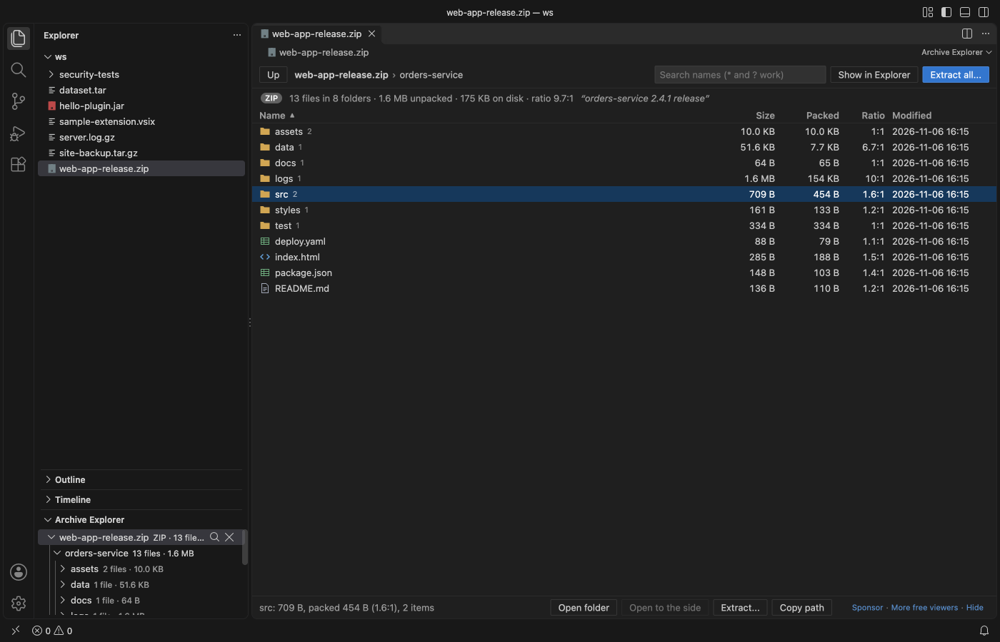
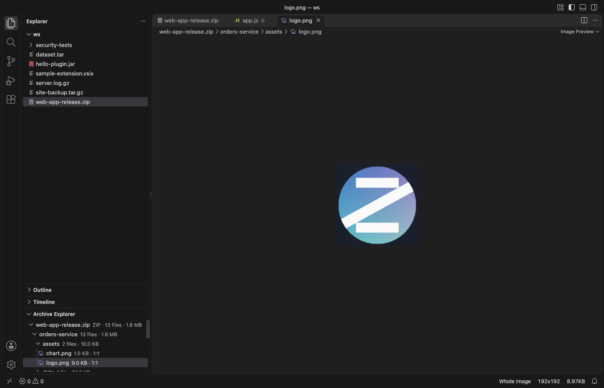
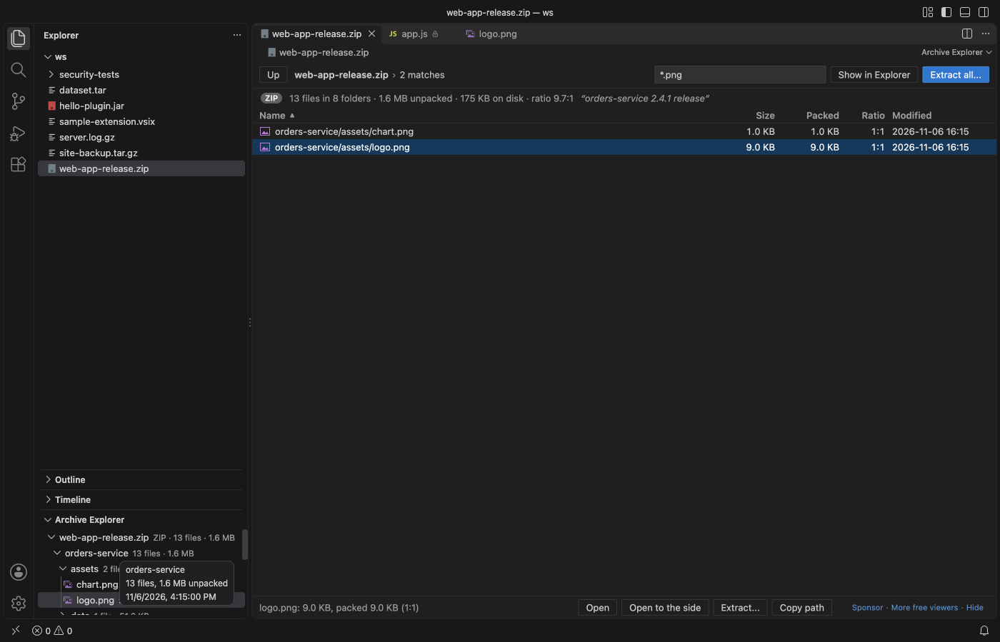
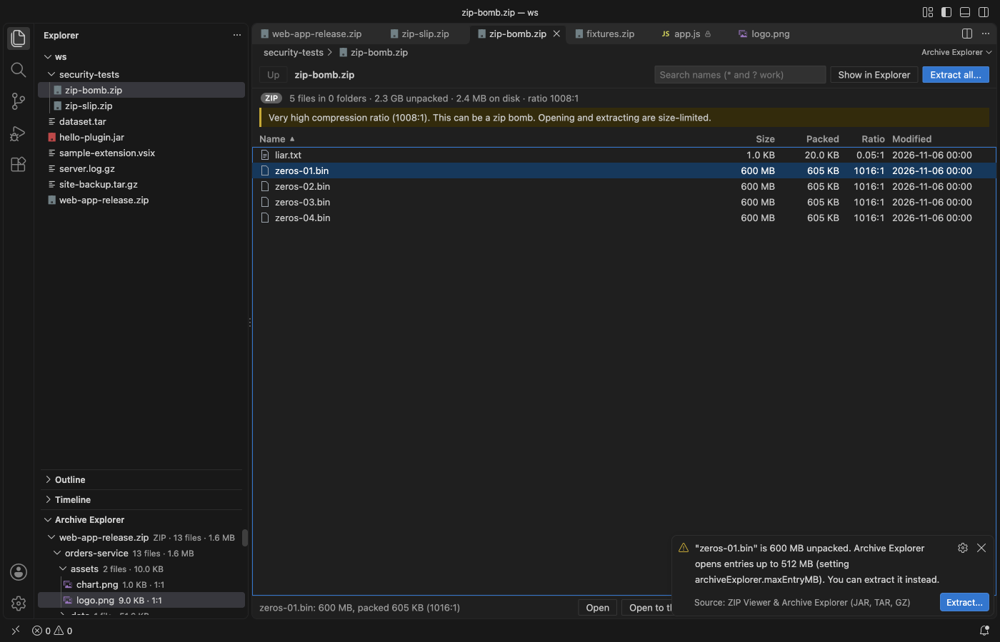
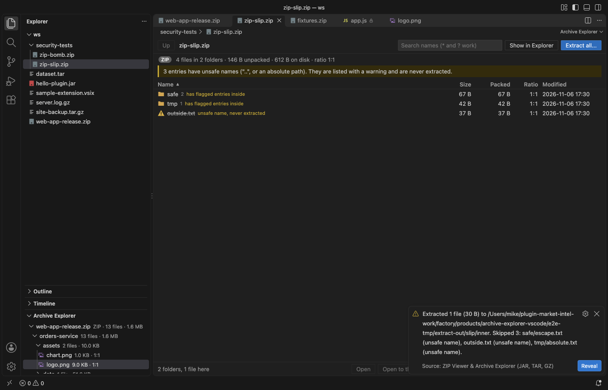
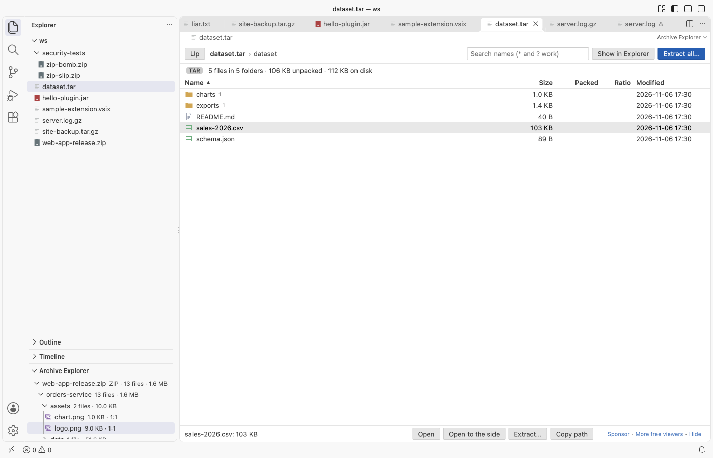

# ZIP Viewer & Archive Viewer (JAR, TAR, GZ)

Look inside ZIP, JAR, VSIX, TAR, TAR.GZ and GZ files in VS Code, open any file in an editor tab, and extract only what you need without unpacking the rest.

*Screenshot from a real VS Code 1.142 window running the packaged extension on `web-app-release.zip`, a sample made by `scripts/make-samples.js`.*

- See what is inside before you unpack. Folders, sizes, packed sizes, compression ratios and dates, for archives with up to 200,000 entries.
- Open any entry in a normal tab. Code gets syntax colors, images open in the image preview, and a ZIP inside a ZIP opens as another archive. Entries are read-only.
- Extract safely. Names with `..` or an absolute path are never written, and size limits stop zip bombs before they fill your disk.

## Quick start

1. Install the extension.
2. Click a `.zip`, `.jar`, `.vsix`, `.tar`, `.tar.gz`, `.tgz` or `.gz` file in the Explorer.

To browse an archive in the side bar instead, right-click it and choose Browse in Archive Explorer.

## What you can do

| Task | How |
|---|---|
| Browse folders | Double-click a folder, use the path bar at the top, or press Backspace to go up. |
| Sort | Click Name, Size, Packed, Ratio or Modified. Folders stay on top. |
| Search names | Type in the search box. Plain text matches anywhere in the path, and `*` and `?` work as wildcards, for example `*.class`. |
| Open an entry | Double-click it or press Enter. Open to the side puts it next to the archive. |
| Extract | Select a file or folder and click Extract..., or use Extract all... for the whole archive. One file goes through a save dialog, a folder through a folder picker. |
| Copy a path | Copy path (or Cmd+C / Ctrl+C) copies the path inside the archive. |
| Side bar tree | The Archive Explorer section of the Explorer lists every archive you opened, with search, Extract, Copy Path and Open to the Side on right-click. |

## Supported files

| Type | Extensions | Notes |
|---|---|---|
| ZIP family | `.zip`, `.jar`, `.vsix` open by default. `.war`, `.ear`, `.whl`, `.nupkg`, `.apk`, `.aar`, `.xpi` and `.epub` open through Open in Archive Explorer. | Stored and Deflate entries, ZIP64, UTF-8 and old DOS names, self-extracting archives. |
| TAR | `.tar` | ustar, GNU long names and pax headers. Links are listed but not created. |
| TAR.GZ | `.tar.gz`, `.tgz` | Unpacked in memory up to the `maxUnpackedMB` limit. |
| GZ | `.gz` | One file. A `.gz` that holds a TAR opens as TAR.GZ. |

Entries open with the editor VS Code picks for their type. That includes other Zovo viewers when you have them, so a CSV inside a ZIP can open in the table viewer.

## Safety

- Zip slip. Entry names with `..`, a leading `/`, a drive letter or a NUL character are listed with a warning and skipped during extraction. The target path is checked again just before each write.
- Zip bombs. An extraction that would write more than `archiveExplorer.maxUnpackedMB` (2 GB by default) is refused before anything is written. An entry that unpacks to more than its header says is stopped. Very high compression ratios get a banner.
- Big archives. Archives with more than `archiveExplorer.maxEntries` entries (200,000 by default) are not read. Entries over `archiveExplorer.maxEntryMB` (512 MB) do not open in a tab but can still be extracted.
- Existing files are kept unless you choose Overwrite. The archive itself is never changed.

## Settings

| Setting | Default | What it does |
|---|---|---|
| `archiveExplorer.maxEntries` | 200000 | Most entries read from one archive, and most files written by one extraction. |
| `archiveExplorer.maxEntryMB` | 512 | Largest entry, in MB, that opens in an editor tab. |
| `archiveExplorer.maxUnpackedMB` | 2048 | Most data, in MB, that one extraction writes. Also the limit for unpacking a `.tar.gz` in memory. |
| `archiveExplorer.askForRating` | true | Ask one time for a Marketplace rating after a few days of use. |
| `archiveExplorer.showSupportLinks` | true | Show the small Sponsor and More free viewers links in the status line. |

## Privacy

The extension works offline. It makes no network calls and has no telemetry. Archives are read from disk with range reads, so a large ZIP or TAR is not loaded whole. The view runs under a strict Content Security Policy, and every name from an archive is shown as plain text.

## Known limits

- Compression methods other than Stored and Deflate (for example BZIP2, LZMA, Zstandard and Deflate64) are listed but not opened. Encrypted entries are listed but not opened.
- 7z, RAR, XZ and BZ2 files are not supported.
- A `.tar.gz` is unpacked in memory, up to 2 GB by default.
- Entries are read-only. Extract a file to change it.
- The size shown for a single `.gz` file comes from its header and is marked with ≈ until the file is opened.

## Support Zovo

Zovo extensions are free, with no ads and no tracking. They are made by [theluckystrike](https://github.com/theluckystrike) on GitHub. If this one saves you time, you can support the work:

- [Sponsor on GitHub](https://github.com/sponsors/theluckystrike)
- [Follow theluckystrike on GitHub](https://github.com/theluckystrike)

## More tools by Zovo

- [Large JSON Viewer & JSON Tree](https://marketplace.visualstudio.com/items?itemName=zovo.zovo-json-tree-viewer) shows large JSON files as a searchable tree, copies JSONPath and turns arrays of objects into a table.
- [SQLite Viewer & DB Viewer (Read-Only)](https://marketplace.visualstudio.com/items?itemName=zovo.sqlite-table-viewer) browses SQLite tables read-only and runs SELECT queries.
- [Graphviz Preview & DOT Viewer](https://marketplace.visualstudio.com/items?itemName=zovo.zovo-graphviz-preview) shows a live preview of DOT files and exports SVG or PNG.
- [CSV Viewer, Excel Viewer (XLSX) & Parquet Viewer](https://marketplace.visualstudio.com/items?itemName=zovo.table-viewer-vscode) opens CSV, TSV, Excel and Parquet files as a sortable, filterable table.

See [all Zovo extensions on the Marketplace](https://marketplace.visualstudio.com/publishers/zovo).

## License

MIT. Bundles fflate (MIT). See THIRD-PARTY-NOTICES.md.
